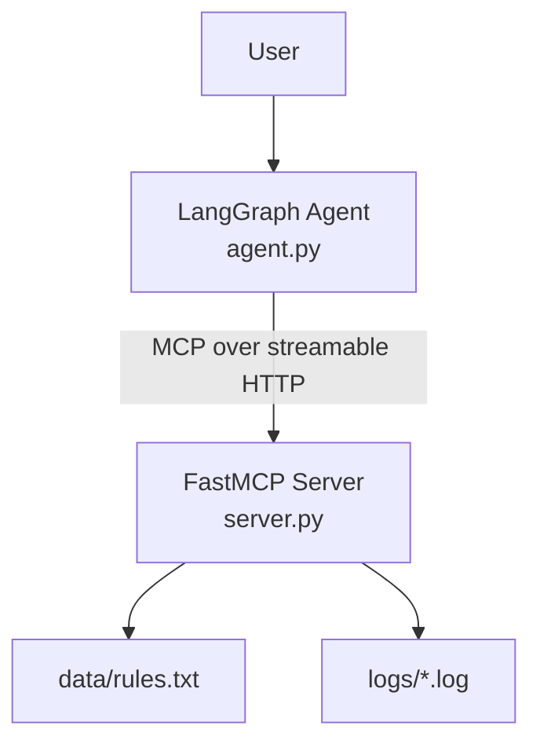
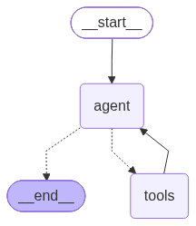
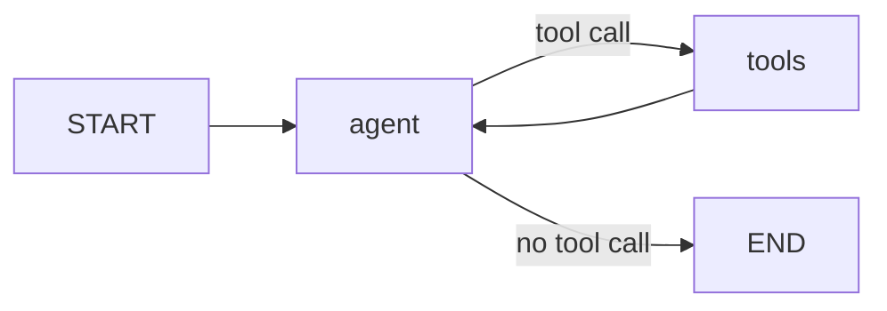

# MCP Log Agent

A company-support AI agent built with **LangGraph**, **FastMCP**, and the **Model Context Protocol (MCP)**.

A LangGraph agent connects to an MCP server, discovers its tools at runtime, and uses them to answer company-policy questions and to diagnose technical problems by searching application logs. The MCP server can be containerized with Docker and deployed to a local Kubernetes cluster with Helm.

## Features

- **Tool discovery over MCP:** the agent loads tools from the server at startup instead of hardcoding them.
- **LangGraph reasoning loop:** the agent can call a tool, read the result, and call another tool before answering.
- **Two workflows:** company-policy lookup and log-based troubleshooting.
- **Structured diagnoses:** technical answers always follow a `Hypothesis / Evidence / Suggested next step` format.
- **Loop protection:** after 5 tool results the agent is forced to produce a final answer without further tool calls.
- **Deployable:** includes a Dockerfile and a Helm chart (Deployment + NodePort Service).

## Architecture



### Agent graph





The `agent` node asks the LLM what to do next. If the LLM requests a tool, `tools_condition` routes execution to the `tools` node (LangGraph's `ToolNode`), which runs the MCP tool and returns the result to the `agent` node. This repeats until the LLM answers without requesting a tool.

## MCP tools

| Tool | Arguments | Description |
|---|---|---|
| `get_company_rules` | none | Returns the contents of `data/rules.txt` (working hours, leave, refunds, expenses, IT policy). |
| `get_log_file_names` | none | Lists the `.log` / `.txt` files in `logs/`, each with its first line as a preview. |
| `search_log` | `file_name`, `keyword`, `limit` (default 20) | Case-insensitive substring search in one log file. Returns matching lines **newest first** with their line numbers. |

`search_log` strips any directory components from `file_name`, so only files directly inside `logs/` can be read.

## Agent workflows

**Company policy questions** (e.g. *"What are the working hours?"*)

1. The agent calls `get_company_rules`.
2. It answers only from the returned text. If the answer isn't there, it says: *"I could not find this information in the company rules."*

**Technical problems** (e.g. *"Why are my payments failing?"*)

1. The agent calls `get_log_file_names` and picks the most relevant file.
2. It calls `search_log` with one keyword (`error`, `failed`, `timeout`, `refused`, `denied`, ...).
3. If the result is empty or unhelpful, it retries with a different keyword; it never repeats the same file and keyword pair.
4. It replies in this format:

```text
Hypothesis: <most likely cause>

Evidence: <relevant log entries>

Suggested next step: <recommended action>
```

## Project structure

```text
.
├── agent.py            # LangGraph agent and interactive CLI
├── server.py           # FastMCP server exposing the three tools
├── requirements.txt
├── Dockerfile
├── .dockerignore
├── langgraph.png       # Agent graph diagram
└── helm/
    ├── Chart.yaml
    ├── values.yaml
    └── templates/
        ├── deployment.yaml
        └── service.yaml
```

These are **not** in the repository (they are git-ignored) and you must create them locally:

```text
├── data/
│   └── rules.txt
├── logs/
│   ├── auth.log
│   ├── database.log
│   └── payment.log
└── .env
```

## Getting started

### Prerequisites

- Python 3.12 (the Docker image uses 3.12)
- An OpenAI-compatible chat endpoint whose model supports **tool calling**
- Optional: Docker, `kubectl`, Helm, and a local Kubernetes cluster (Docker Desktop, minikube, or kind)

### 1. Install

```bash
git clone https://github.com/Binomial77/MCP-Log-agent.git
cd MCP-Log-agent
python -m venv .venv
source .venv/bin/activate        # Windows: .venv\Scripts\activate
pip install -r requirements.txt
```

### 2. Create the data and log files

The server reads `data/rules.txt` and everything in `logs/`. Create them before starting the server (and before building the Docker image, because the image copies whatever is in the project folder).

```bash
mkdir data logs
```

`data/rules.txt` can be any plain text. For example:

```text
Working hours: Monday to Friday, 9:00 AM to 6:00 PM.
Leave policy: 24 paid leave days per year.
Refund policy: Refunds are processed within 7 business days.
Expense policy: Claims must be submitted within 30 days with receipts.
IT policy: Use company-issued devices and enable MFA.
```

Each log file is plain text with one entry per line. For example, `logs/payment.log`:

```text
2026-10-19 09:58:12 INFO  payment-service started
2026-10-19 10:02:41 ERROR payment gateway timeout after 30s (order=8841)
2026-10-19 10:02:42 WARN  retrying payment for order=8841
2026-10-19 10:03:05 ERROR connection refused: gateway.internal:443
```

The first line of each file is used as its preview in `get_log_file_names`.

### 3. Configure the LLM

Create a `.env` file in the project root:

```env
BROKER_URL=<your-openai-compatible-base-url>
API_KEY=<your-api-key>
MODEL_NAME=<your-model-name>
```

If `BROKER_URL` ends with `/chat/completions`, that suffix is stripped automatically. The agent exits with an error if any of the three variables is missing.

### 4. Run the MCP server

```bash
python server.py
```

The server listens on `0.0.0.0:5000`; the MCP endpoint is `http://localhost:5000/mcp`.

### 5. Run the agent

The agent connects to **`http://localhost:30000/mcp`** (the Kubernetes NodePort, see below). If you run the server directly with `python server.py`, edit the `url` in `agent.py` to `http://localhost:5000/mcp`:

```python
client = MultiServerMCPClient(
    {
        "support": {
            "url": "http://localhost:5000/mcp",
            "transport": "streamable_http",
        }
    }
)
```

Then start the agent:

```bash
python agent.py
```

Example session:

```text
Connected to MCP server.
Available tools:
  - get_company_rules
  - get_log_file_names
  - search_log

Company Support Agent started.
Type 'exit' to stop.

Ask: Why are payments failing?

Tool execution history:
  - get_log_file_names({})
  - search_log({'file_name': 'payment.log', 'keyword': 'error'})

Answer:
Hypothesis: The payment gateway is timing out and refusing connections.
Evidence: ...
Suggested next step: ...
```

Each question is answered independently; the agent does not keep conversation history between questions.

## Docker

Build from the project root (after creating `data/` and `logs/`):

```bash
docker build -t agent-mcp-server:latest .
docker run --rm -p 5000:5000 agent-mcp-server:latest
```

To use your own logs without rebuilding, mount them:

```bash
docker run --rm -p 5000:5000 \
  -v "$(pwd)/logs:/app/logs" -v "$(pwd)/data:/app/data" \
  agent-mcp-server:latest
```

## Kubernetes with Helm

The chart in `helm/` deploys the server as a single-replica Deployment exposed through a NodePort Service.

| Value | Default |
|---|---|
| `replicaCount` | `1` |
| `image.repository` / `image.tag` | `agent-mcp-server` / `latest` |
| `image.pullPolicy` | `Never` (the image must already exist in the cluster) |
| `container.port` | `5000` |
| `service.type` | `NodePort` |
| `service.port` / `service.targetPort` / `service.nodePort` | `5000` / `5000` / `30000` |

Because `pullPolicy` is `Never`, make the image available to your cluster first:

```bash
# Docker Desktop Kubernetes: nothing extra needed
# minikube:
minikube image load agent-mcp-server:latest
# kind:
kind load docker-image agent-mcp-server:latest
```

Install the chart:

```bash
helm install agent-mcp-server ./helm
kubectl get pods
kubectl get svc agent-mcp-service
```

On Docker Desktop the endpoint is `http://localhost:30000/mcp`, which matches the default in `agent.py`. On minikube, use `minikube service agent-mcp-service --url` to get the address, or run `kubectl port-forward svc/agent-mcp-service 30000:5000`.

To update or remove the release:

```bash
helm upgrade agent-mcp-server ./helm
helm uninstall agent-mcp-server
```

## Troubleshooting

| Symptom | Likely cause and fix |
|---|---|
| `FileNotFoundError` for `rules.txt` or the `logs` folder | `data/` and `logs/` are git-ignored. Create them (step 2). |
| `BROKER_URL / API_KEY / MODEL_NAME is missing` | Create `.env` in the project root (step 3). |
| Connection refused on `localhost:30000` | The server isn't deployed to Kubernetes. Run it locally and change the agent URL to port `5000`, or deploy with Helm. |
| `ImagePullBackOff` / `ErrImageNeverPull` | The image isn't in the cluster. Load it with `minikube image load` or `kind load docker-image`. |
| Agent never calls tools | The configured model doesn't support native tool calling. Use one that does. |

## Limitations

- Log search is a plain substring match; there is no regex, time filtering, or multi-file search.
- Whole log files are read into memory, so very large logs will be slow.
- The MCP endpoint has no authentication and binds to `0.0.0.0`. Don't expose it beyond a trusted network.
- The agent has no memory across questions and stops after 5 tool results.

## Tech stack

Python, LangGraph, LangChain, FastMCP, `langchain-mcp-adapters`, `langchain-openai`, Docker, Kubernetes, Helm.